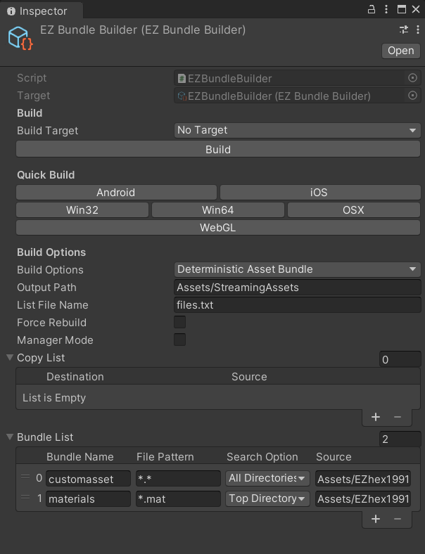
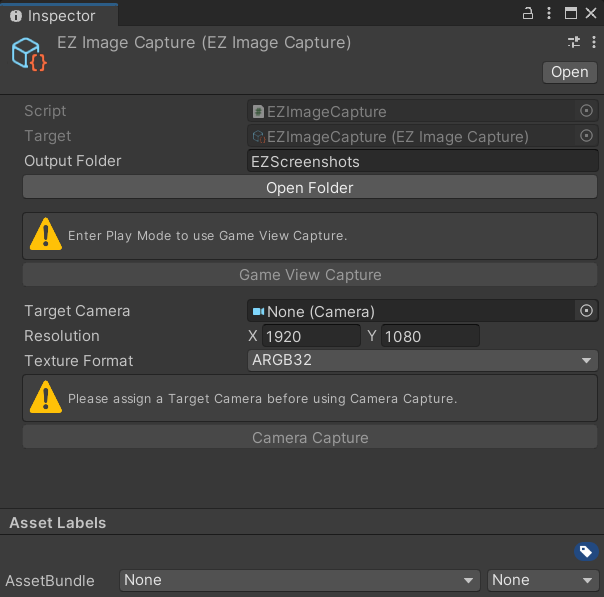
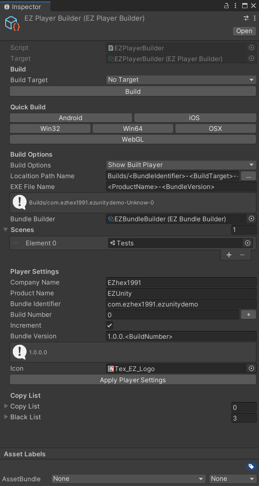
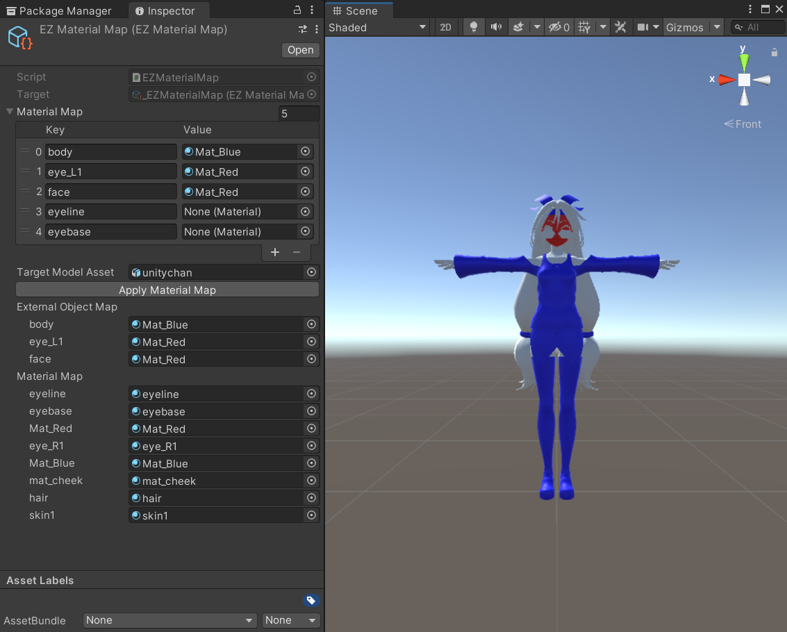
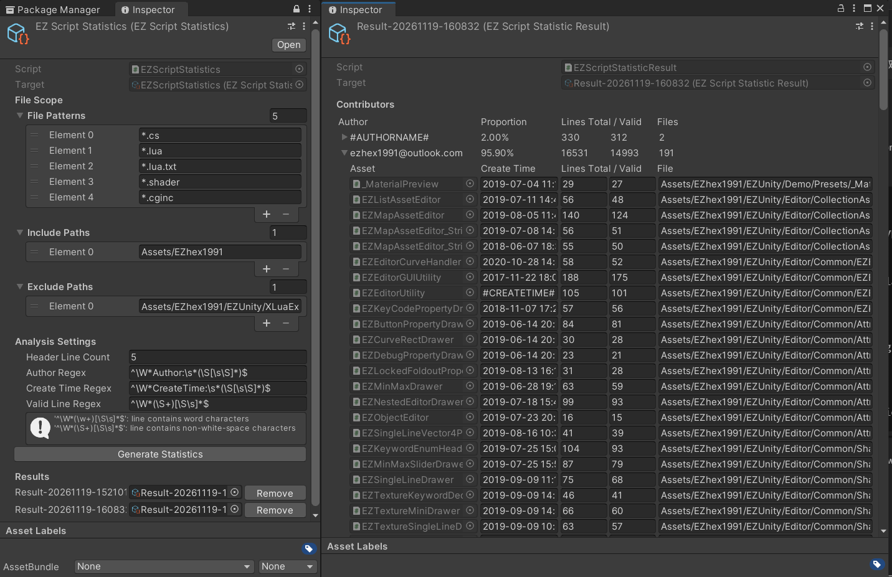

# EZEditorTools

[English](README_EN.md)

EZEditorTools 是一个独立的 Unity 编辑器工具模块，提供通用的编辑器窗口、资源辅助功能和编辑器基础能力。
代码位于 `EZhex1991.EZEditorTools.Editor` 程序集中，仅面向 Unity Editor 平台。

最低支持 Unity 版本：`2020.3.x`。

## 自定义窗口和功能说明

所有窗口和功能均从 Unity 编辑器的 `EZEditorTools` 根菜单访问。以下分组与 `EZMenuOrder` 中的 Section 保持一致。

语言可以通过 `EZEditorTools/Language` 菜单切换为简体中文或 English，默认使用 English，当前语言设置会保存在编辑器本地。该设置仅对已接入本地化的窗口界面生效，不会修改菜单名称。

### Scene Object Active Toggle

| 菜单名称 | 说明 |
| --- | --- |
| `场景对象快捷开关丨Scene Object Active Toggle` | 使用编辑器本地设置控制是否在 Hierarchy 中显示 GameObject 的 Active Toggle。 |

### 项目和编辑器操作

| 菜单名称 | 说明 |
| --- | --- |
| `保存资产修改丨Save Assets` | Editor 下序列化资源文件的修改不会立即写入磁盘，使用该菜单可以强制保存资源文件。 |
| `刷新资产目录丨Refresh AssetDatabase` | 刷新 Unity AssetDatabase。 |
| `打开持久化目录丨Open Persistent Folder` | 打开 Unity 的持久化数据目录。 |
| `清空持久化目录丨Clear Persistent Folder` | 清空 Unity 的持久化数据目录。 |
| `PlayerPrefs Editor` | 查看、修改和删除 PlayerPrefs 数据，目前仅支持 Windows。 |
| `EditorPrefs Editor` | 查看、修改和删除 EditorPrefs 数据，目前仅支持 Windows。 |

### 资源处理

| 菜单名称 | 功能 |
| --- | --- |
| `批量重命名丨Renamer` | 批量重命名工具窗口，支持正则式匹配，整理资源目录很方便。 |
| `图片画布工具丨Image Canvas Tool` | 检查图片分辨率，并将不符合 4 的倍数要求的图片画布扩展到最近的 4 的倍数。 |
| `材质优化器丨Material Optimizer` | 查看和删除材质中的 Keywords 和多余的 Properties，也可以迁移旧的 Property。 |

### 资源关系和构建

| 菜单名称 | 功能 |
| --- | --- |
| `资源引用查看器丨Asset Reference Viewer` | 查看资源依赖关系和场景引用。 |
| `对应物体查看器丨Corresponding Object Viewer` | 查看对象及其对应的源对象和资源。 |
| `字体引用查看器丨Font Reference Viewer` | 查找引用指定字体的 UI 文本组件。 |
| `层级差异检查器丨Hierarchy Diff Checker` | 对比两个 Transform 层级结构的差异。 |
| `属性路径查看器丨Property Path Viewer` | 查看对象的序列化属性和属性路径。 |
| `Bundle包管理丨Asset Bundle Manager` | 查看和管理基于资源标签的 AssetBundle 构建结果及相关资源。 |

### 调试和辅助工具

| 菜单名称 | 功能 |
| --- | --- |
| `Guid生成器丨Guid Generator` | 生成系统 GUID 和 Unity GUID。 |
| `正则表达式测试丨Regex Tester` | 测试正则表达式，并显示匹配项、分组和捕获结果。 |
| `颜色混合器丨Color Blender` | 预览常见的颜色混合运算结果。 |
| `时间帮助面板丨Time Panel` | 查看和解析当前时间及其各类格式化结果。 |
| `类型反射助手丨Type Reflection Helper` | 通过反射查看类型的字段、属性、方法和枚举值，也可以通过成员名称推断不可直接访问的类型信息。 |

### 实验性功能

| 菜单名称 | 功能 |
| --- | --- |
| `实验性功能丨Experimental/Shader关键字管理丨Shader Keyword Manager` | 查看和管理材质及 Shader 的关键字状态。 |
| `实验性功能丨Experimental/动画控制器合并器丨Animator Controller Combiner` | 通过编辑器窗口合并 Animator Controller 数据。 |

## 自定义资产和功能说明

| 创建菜单名称 | 功能 |
| --- | --- |
| `Asset List Renamer` | 保存资源列表和重命名规则，并执行批量重命名。 |
| `Script Statistics` | 用来统计代码量的工具，可以通过正则式对指定范围内的代码文件进行分类统计，并生成贡献者和行数统计结果。 |
| `Image Capture` | 保存截图分辨率、纹理格式和输出目录配置，执行 Game View 或 Camera 截图；Game View 截图需要处于 Play Mode，Camera 截图需要指定 Target Camera。 |
| `Bundle Builder` | 保存 AssetBundle 构建配置，并执行 AssetBundle 构建，支持 Android、iOS、Win32、Win64、OSX 和 WebGL 快捷构建。 |
| `Player Builder` | 保存 Player 构建配置，并执行 Player 构建流程。 |
| `Material Map` | 保存模型材质名称与材质资源的映射，通过 `Apply Material Map` 将映射应用到模型导入器。 |

自定义资产示例可以通过 **Window > Package Manager > EZEditorTools > Samples** 导入。

示例资产位于 `Samples~/Demo/CustomAssets`，说明和示例图片位于 `Documentation~/Images`。

其中 `Bundle Builder` 示例包含 EZ Bundle 模式和 Manager 模式的配置示例，`Script Statistics` 示例包含代码统计配置示例。

`Material Map` 示例包含模型、材质和测试场景，用于演示将模型材质名称映射到指定材质资源。

**Bundle Builder**



**Image Capture**



**Player Builder**



**Material Map**



**Script Statistics**



### 其他编辑器功能

- `Transform Context Menu`：为 Transform Inspector 提供重置和对齐相关的右键菜单功能。
- 图片资源 Inspector：提供 `Expand Canvas to Multiple of 4` 按钮，使用透明填充和中心 Pivot 将当前图片画布扩展到最近的 4 的倍数；符合要求时按钮不可用。

## 目录结构和脚本说明

以下目录树列出当前模块中的目录、脚本和程序集定义。为便于阅读，省略 Unity 自动生成的 `.meta` 文件。

```text
EZEditorTools/                                    — EZEditorTools 模块根目录。
├── package.json                                  — Unity Package Manager 包元数据。
├── README.md                                     — 中文模块说明文档。
├── README_EN.md                                  — 英文模块说明文档。
├── Documentation~/Images/                         — README 使用的示例图片。
├── Samples~/Demo/CustomAssets/                    — 自定义资产示例。
│   ├── EZBundleBuilder.asset                      — Bundle Builder 配置示例。
│   ├── EZImageCapture.asset                       — Image Capture 配置示例。
│   ├── EZPlayerBuilder.asset                      — Player Builder 配置示例。
│   └── EZScriptStatistics.asset                   — Script Statistics 配置示例。
├── Samples~/Demo/MaterialMap/                     — Material Map 模型、材质和场景示例。
│   ├── _EZMaterialMap.asset                       — Material Map 配置示例。
│   ├── _Test.unity                                — Material Map 测试场景。
│   ├── unitychan.fbx                              — 测试模型。
│   └── Mat_*.mat                                  — 测试材质。
└── Editor/                                       — 编辑器脚本和程序集定义目录。
    ├── EZEditorToolsMenuItems.cs                 — EZEditorTools 总菜单入口，注册窗口和通用编辑器操作。
    ├── EZMenuOrder.cs                            — 定义顶部菜单和自定义资产菜单的显示顺序。
    ├── EZLocalization.cs                         — 定义语言选项，并提供语言选择、文本查询和中英文文本。
    ├── EZhex1991.EZEditorTools.Editor.asmdef     — 定义仅面向 Unity Editor 的程序集。
    ├── Common/                                   — 编辑器内部复用的基础脚本和辅助实现。
    │   ├── EZButtonPropertyAttribute.cs           — 定义可在 Inspector 中调用对象方法的按钮特性。
    │   ├── EZButtonPropertyDrawer.cs              — 绘制 `EZButtonPropertyAttribute` 对应的 Inspector 按钮。
    │   ├── EZCopyList.cs                         — 定义文件复制列表及其 Inspector 绘制器。
    │   ├── EZEditorPreferenceKeys.cs              — 集中定义 EZEditorTools 使用的 EditorPrefs 键名。
    │   ├── EZEditorGUIUtility.cs                 — 提供通用编辑器 GUI 绘制辅助方法。
    │   ├── EZEditorUtility.cs                    — 提供编辑器资源、类型和着色器查询辅助方法。
    │   ├── EZGameViewUtility.cs                  — 访问 Unity Game View，并读取或修改当前目标 Display。
    │   ├── MaterialExt.cs                        — 提供材质关键字设置、禁用和查询的扩展方法。
    │   ├── EZShaderGUIUtility.cs                 — 提供材质 Shader 属性、关键字和额外属性的绘制及优化方法。
    │   └── TransformExt.cs                       — 提供 Transform 扩展方法，包括层级 Transform 的 TRS 复制。
    ├── General/                                  — 存放一般用途的编辑器窗口和功能。
    │   ├── EZAnimatorControllerCombiner.cs       — 合并 Animator Controller 数据的窗口。
    │   ├── EZAssetReferenceViewer.cs             — 查看资源依赖关系和场景引用的窗口。
    │   ├── EZColorBlender.cs                     — 预览颜色混合运算结果的窗口。
    │   ├── EZCorrespondingObjectViewer.cs        — 查看对象及其对应源对象和资源的窗口。
    │   ├── EZFontReferenceViewer.cs              — 查找 UI 文本组件字体引用的窗口。
    │   ├── EZGuidGenerator.cs                    — 生成系统 GUID 和 Unity GUID 的窗口。
    │   ├── EZHierachyDiffChecker.cs              — 对比两个 Transform 层级结构的窗口。
    │   ├── EZPlayerPrefsEditor.cs                — 查看、修改和删除 PlayerPrefs 的窗口。
    │   ├── EZEditorPrefsEditor.cs                — 查看、修改和删除 EditorPrefs 的窗口。
    │   ├── EZPropertyPathViewer.cs               — 查看序列化属性和属性路径的窗口。
    │   ├── EZRegexTester.cs                      — 测试正则表达式的窗口。
    │   ├── EZShaderKeywordManager.cs             — 查看和管理材质及 Shader 关键字的窗口。
    │   ├── EZMaterialOptimizer.cs                — 批量优化选中材质属性的窗口。
    │   ├── EZTimePanel.cs                        — 查看和解析时间信息的窗口。
    │   ├── EZTransformContextMenu.cs              — 为 Transform Inspector 提供重置和对齐右键菜单。
    │   ├── EZTypeReflectionHelper.cs             — 查看类型反射信息的窗口。
    │   ├── EZImageCanvasTool.cs                  — 检查图片分辨率，并按填充颜色和九宫格 Pivot 扩展画布。
    │   └── EZImageCanvasInspectorExtension.cs    — 在图片 Inspector 中提供画布扩展按钮。
    ├── MaterialMap/                              — 共同实现材质映射资产及其 Inspector 的脚本集合。
    │   ├── EZMapAsset.cs                         — 提供可序列化键值映射资产的基础实现。
    │   ├── EZMapAssetEditor.cs                   — 提供键值映射资产的通用 Inspector 和列表绘制。
    │   ├── EZMaterialMap.cs                      — 保存模型材质名称与材质资源的映射资产。
    │   └── EZMaterialMapEditor.cs                — 绘制 `EZMaterialMap` 的映射、外部对象和材质信息。
    ├── Renamer/                                  — 共同实现资源重命名工具的脚本集合。
    │   ├── EZAssetListRenamer.cs                 — 保存资源列表和重命名规则的编辑器资产。
    │   ├── EZAssetListRenamerEditor.cs           — `EZAssetListRenamer` 的 Inspector。
    │   └── EZRenamerWindow.cs                    — 通用重命名窗口。
    ├── ScriptStatistics/                         — 共同实现脚本统计工具的脚本集合。
    │   ├── EZScriptStatisticResult.cs            — 保存单次脚本统计结果的子资产。
    │   ├── EZScriptStatisticResultEditor.cs      — `EZScriptStatisticResult` 的 Inspector。
    │   ├── EZScriptStatistics.cs                 — 保存脚本统计配置的编辑器资产。
    │   └── EZScriptStatisticsEditor.cs           — `EZScriptStatistics` 的 Inspector 和统计执行界面。
    ├── Builder/                                  — 共同实现 AssetBundle 和 Player 构建工具的脚本集合。
    │   ├── EZBuilderOptions.cs                   — 定义构建相关选项。
    │   ├── EZBundleBuilder.cs                    — 保存并执行 AssetBundle 构建配置。
    │   ├── EZBundleBuilderEditor.cs              — `EZBundleBuilder` 的 Inspector。
    │   ├── EZBundleManager.cs                    — AssetBundle 管理窗口。
    │   ├── EZPlayerBuilder.cs                    — 保存并执行 Player 构建配置。
    │   └── EZPlayerBuilderEditor.cs              — `EZPlayerBuilder` 的 Inspector。
    └── ImageCapture/                             — 共同实现截图工具的脚本集合。
        ├── EZImageCapture.cs                     — 保存截图配置并执行截图。
        └── EZImageCaptureEditor.cs               — `EZImageCapture` 的 Inspector 和操作界面。
```
