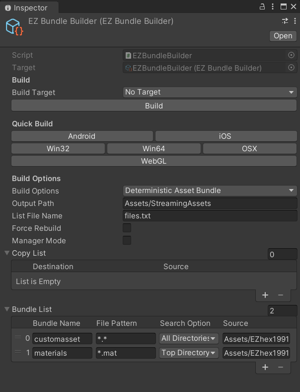
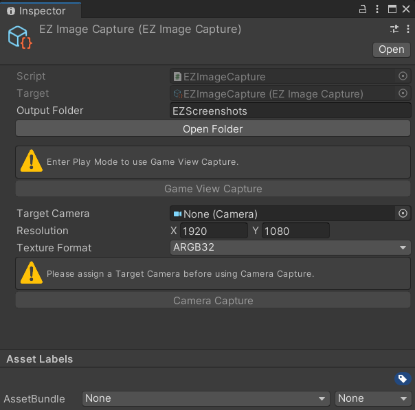
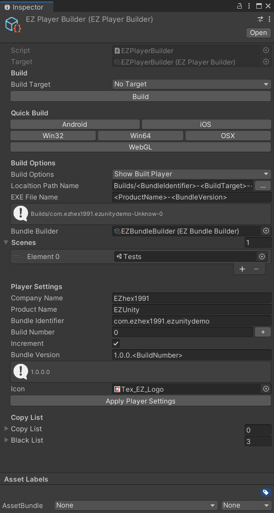
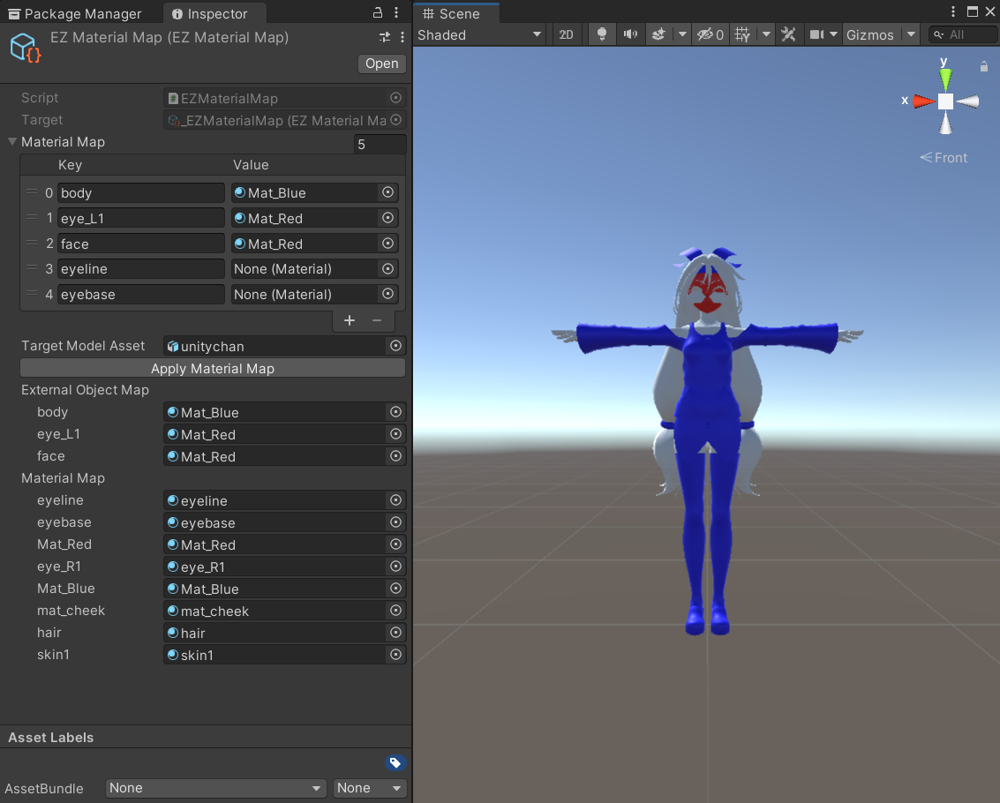
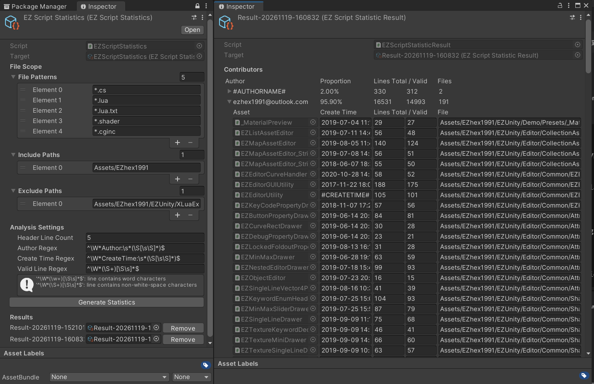

# EZEditorTools

[中文](README.md)

EZEditorTools is a Unity editor tools module that provides general-purpose editor windows, asset utilities, and editor foundations.

The code is defined in the `EZhex1991.EZEditorTools.Editor` assembly and targets the Unity Editor platform only.

Minimum supported Unity version: `2020.3.x`.

## Custom Windows and Features

All windows and features can be accessed from the `EZEditorTools` root menu in the Unity Editor. The following groups match the Sections in `EZMenuOrder`.

The language can be switched between System, 简体中文, and English from `EZEditorTools/Language`. The selected language is saved locally in the editor and only affects localized window UI; menu names are not changed.

### Project and editor operations

| Menu name | Description |
| --- | --- |
| `Save Assets` | Forces serialized asset changes made in the Editor to be written to disk. |
| `Refresh AssetDatabase` | Refreshes the Unity AssetDatabase. |
| `Open Persistent Folder` | Opens Unity's persistent data directory. |
| `Clear Persistent Folder` | Clears Unity's persistent data directory. |
| `Hierarchy Active Toggle` | Uses an editor-local preference to control whether GameObject Active toggles are shown in the Hierarchy. |
| `PlayerPrefs Editor` | Views, edits, and deletes PlayerPrefs data. Currently supported on Windows only. |
| `EditorPrefs Editor` | Views, edits, and deletes EditorPrefs data. Currently supported on Windows only. |

### Asset operations

| Menu name | Description |
| --- | --- |
| `Renamer` | Batch-renames assets with regular-expression matching, useful for organizing asset directories. |
| `Image Canvas Tool` | Checks image resolutions and expands canvases that do not meet the multiple-of-4 requirement. |
| `Material Optimizer` | Views and removes material keywords and redundant properties, and can migrate legacy properties. |

### Asset relationships and build results

| Menu name | Description |
| --- | --- |
| `Asset Reference Viewer` | Views asset dependencies and scene references. |
| `Corresponding Object Viewer` | Views objects and their corresponding source objects and assets. |
| `Font Reference Viewer` | Finds UI text components that reference a specified font. |
| `Hierarchy Diff Checker` | Compares differences between two Transform hierarchies. |
| `Property Path Viewer` | Views serialized properties and property paths. |
| `Asset Bundle Manager` | Views and manages AssetBundle build results and related assets based on asset labels. |

### Debugging and utility tools

| Menu name | Description |
| --- | --- |
| `Guid Generator` | Generates system GUIDs and Unity GUIDs. |
| `Regex Tester` | Tests regular expressions and displays matches, groups, and captures. |
| `Color Blender` | Previews common color blending operations. |
| `Time Panel` | Views and parses current time information in multiple formats. |
| `Type Reflection Helper` | Uses reflection to view fields, properties, methods, and enum values, and infer information about otherwise inaccessible types from their member names. |
| `Image Canvas Tool` | Collects selected images, images in the selected folder, or images in the selected folder and its subfolders; displays resolutions, highlights dimensions that are not multiples of 4 in red, and can expand the canvas using a fill color and a nine-point pivot. |

### Experimental features

| Menu name | Description |
| --- | --- |
| `Shader Keyword Manager` | Views and manages material and Shader keyword states. |
| `Animator Controller Combiner` | Combines Animator Controller data through an editor window. |

### Other editor features

- `Transform Context Menu`: Provides Transform Inspector context menu operations for resetting and aligning transforms.

## Custom Assets and Features

| Create menu name | Description |
| --- | --- |
| `Asset List Renamer` | Stores asset lists and renaming rules, then performs batch renaming. |
| `Script Statistics` | Analyzes code files within the selected scope using regular expressions and generates contributor and line-count statistics. |
| `Image Capture` | Stores capture resolution, texture format, and output folder settings for Game View or Camera captures. Game View capture requires Play Mode, while Camera capture requires a Target Camera. |
| `Bundle Builder` | Stores AssetBundle build settings and supports quick builds for Android, iOS, Win32, Win64, OSX, and WebGL. |
| `Player Builder` | Stores Player build settings and executes the Player build workflow. |
| `Material Map` | Stores model material-to-asset mappings and applies them to model importers through `Apply Material Map`. |

The custom asset samples can be imported from **Window > Package Manager > EZEditorTools > Samples**.

The sample assets are located at `Samples~/Demo/CustomAssets`, while the documentation and sample images are located at `Documentation~/Images`.

The `Bundle Builder` samples include configurations for EZ Bundle mode and Manager mode. The `Script Statistics` sample includes a script statistics configuration.

The `Material Map` sample includes a model, materials, and a test scene demonstrating how model material names are mapped to specified material assets.

**Bundle Builder**



**Image Capture**



**Player Builder**



**Material Map**



**Script Statistics**



### Other Editor Features

- `Transform Context Menu`: Provides Transform Inspector context menu operations for resetting and aligning transforms.
- Image Inspector: Adds an `Expand Canvas to Multiple of 4` button that expands the current image canvas using transparent fill and a centered pivot. The button is disabled when the resolution is already valid.

## Directory Structure

The following tree lists the directories, scripts, and assembly definition in this package. Unity-generated `.meta` files are omitted for readability.

```text
EZEditorTools/                                    — EZEditorTools package root.
├── package.json                                  — Unity Package Manager metadata.
├── README.md                                     — Chinese package documentation.
├── README_EN.md                                  — English package documentation.
├── Documentation~/Images/                         — Sample images used by the documentation.
├── Samples~/Demo/CustomAssets/                    — Custom asset samples.
│   ├── EZBundleBuilder.asset                      — Bundle Builder configuration sample.
│   ├── EZImageCapture.asset                       — Image Capture configuration sample.
│   ├── EZPlayerBuilder.asset                      — Player Builder configuration sample.
│   └── EZScriptStatistics.asset                   — Script Statistics configuration sample.
├── Samples~/Demo/MaterialMap/                     — Material Map model, material, and scene samples.
│   ├── _EZMaterialMap.asset                       — Material Map configuration sample.
│   ├── _Test.unity                                — Material Map test scene.
│   ├── unitychan.fbx                              — Test model.
│   └── Mat_*.mat                                  — Test materials.
└── Editor/                                       — Editor scripts and assembly definition.
    ├── EZEditorToolsMenuItems.cs                 — Root menu entries for EZEditorTools windows and editor operations.
    ├── EZMenuOrder.cs                            — Display order definitions for menus and custom assets.
    ├── Localization/                             — Editor UI localization support.
    │   ├── EZLocalization.cs                     — Defines language options and provides language selection, text lookup, and JSON language loading.
    │   ├── EZLocalizationMenuItems.cs            — Provides language selection menu items.
    │   └── Languages/                            — Editable language JSON files.
    │       ├── zh-CN.json                       — Simplified Chinese text.
    │       └── en-US.json                       — English text.
    ├── EZhex1991.EZEditorTools.Editor.asmdef     — Editor-only assembly definition.
    ├── Common/                                   — Shared editor utilities and supporting implementations.
    │   ├── EZButtonPropertyAttribute.cs           — Defines an Inspector button attribute for invoking object methods.
    │   ├── EZButtonPropertyDrawer.cs              — Draws Inspector buttons for `EZButtonPropertyAttribute`.
    │   ├── EZCopyList.cs                          — Defines file copy lists and their Inspector drawer.
    │   ├── EZEditorGUIUtility.cs                  — Common editor GUI drawing helpers.
    │   ├── EZEditorUtility.cs                     — Editor asset, type, and shader query helpers.
    │   ├── EZGameViewUtility.cs                   — Accesses the Unity Game View and its target Display.
    │   ├── EZShaderGUIUtility.cs                  — Shader property, keyword, and material optimization helpers.
    │   ├── MaterialExt.cs                         — Material keyword and property extension methods.
    │   └── TransformExt.cs                        — Transform extension methods, including TRS copying.
    ├── General/                                  — General-purpose editor windows and tools.
    │   ├── EZAnimatorControllerCombiner.cs        — Combines Animator Controller data.
    │   ├── EZAssetReferenceViewer.cs              — Views asset dependencies and scene references.
    │   ├── EZColorBlender.cs                      — Previews color blending results.
    │   ├── EZCorrespondingObjectViewer.cs         — Views objects and their corresponding source assets.
    │   ├── EZFontReferenceViewer.cs               — Finds UI text components that reference a font.
    │   ├── EZGuidGenerator.cs                     — Generates system and Unity GUIDs.
    │   ├── EZHierachyDiffChecker.cs               — Compares two Transform hierarchies.
    │   ├── EZMaterialOptimizer.cs                 — Batch-optimizes selected material properties.
    │   ├── EZPlayerPrefsEditor.cs                 — Views, edits, and deletes PlayerPrefs data.
    │   ├── EZEditorPrefsEditor.cs                 — Views, edits, and deletes EditorPrefs data.
    │   ├── EZPropertyPathViewer.cs                — Views serialized properties and property paths.
    │   ├── EZRegexTester.cs                       — Tests regular expressions.
    │   ├── EZShaderKeywordManager.cs              — Views and manages material and Shader keywords.
    │   ├── EZTimePanel.cs                         — Views and parses time information.
    │   ├── EZTransformContextMenu.cs              — Provides Transform Inspector context menu operations.
    │   ├── EZTypeReflectionHelper.cs              — Views type reflection information.
    │   ├── EZImageCanvasTool.cs                   — Checks image resolutions and expands canvases using a fill color and nine-point pivot.
    │   └── EZImageCanvasInspectorExtension.cs     — Adds a canvas expansion button to image inspectors.
    ├── MaterialMap/                              — Material mapping assets and inspectors.
    │   ├── EZMapAsset.cs                          — Base implementation for serializable key-value map assets.
    │   ├── EZMapAssetEditor.cs                    — Common Inspector and list drawer for map assets.
    │   ├── EZMaterialMap.cs                       — Stores model material-to-asset mappings.
    │   └── EZMaterialMapEditor.cs                 — Draws material mapping and related information.
    ├── Renamer/                                  — Asset renaming tool scripts.
    │   ├── EZAssetListRenamer.cs                  — Editor asset for asset lists and renaming rules.
    │   ├── EZAssetListRenamerEditor.cs            — Inspector for `EZAssetListRenamer`.
    │   └── EZRenamerWindow.cs                     — General-purpose renaming window.
    ├── ScriptStatistics/                         — Script statistics asset and editor scripts.
    │   ├── EZScriptStatisticResult.cs             — Stores a single script statistics result as a sub-asset.
    │   ├── EZScriptStatisticResultEditor.cs       — Inspector for `EZScriptStatisticResult`.
    │   ├── EZScriptStatistics.cs                  — Stores script statistics settings.
    │   └── EZScriptStatisticsEditor.cs            — Inspector and execution interface for script statistics.
    ├── Builder/                                  — AssetBundle and Player build tool scripts.
    │   ├── EZBuilderOptions.cs                    — Defines build-related options.
    │   ├── EZBundleBuilder.cs                     — Stores and executes AssetBundle build settings.
    │   ├── EZBundleBuilderEditor.cs               — Inspector for `EZBundleBuilder`.
    │   ├── EZBundleManager.cs                     — AssetBundle management window.
    │   ├── EZPlayerBuilder.cs                     — Stores and executes Player build settings.
    │   └── EZPlayerBuilderEditor.cs               — Inspector for `EZPlayerBuilder`.
    └── ImageCapture/                             — Image capture asset and editor scripts.
        ├── EZImageCapture.cs                     — Stores capture settings and executes captures.
        └── EZImageCaptureEditor.cs               — Inspector and operation interface for `EZImageCapture`.
```
